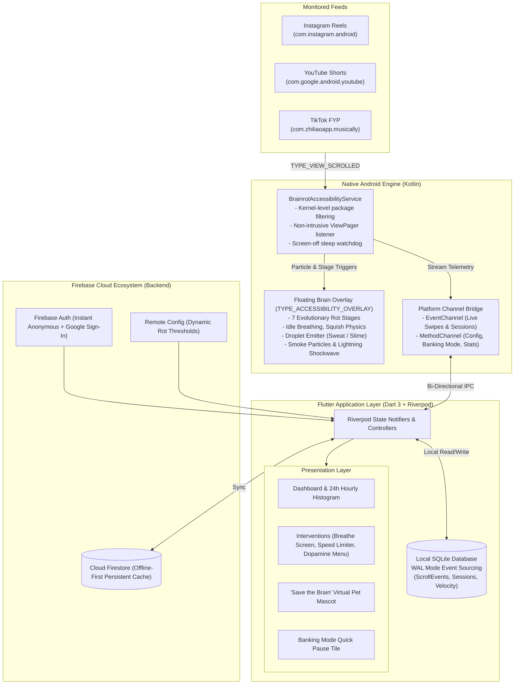

# 🧠 Brainrot Tracker Pro

<p align="center">
  
</p>

<p align="center">
  <strong>An intelligent, battery-efficient short-form video tracking and anti-doomscroll ecosystem.</strong><br>
  Built with <strong>Flutter (Dart 3)</strong>, <strong>Firebase</strong>, and a low-latency <strong>Android Native Accessibility Engine</strong>.
</p>

<p align="center">
  
  
  
  
  
  
  
</p>

---

## 🌟 Executive Overview

**Brainrot Tracker Pro** addresses digital media addiction by accurately tracking short-form video consumption across **Instagram Reels**, **YouTube Shorts**, and **TikTok**. 

Unlike conventional screen-time trackers that rely on coarse hourly app limits or battery-draining screen scraping, **Brainrot Tracker Pro** introduces:
1. **Zero-Tree-Traversal Detection**: Intercepts ViewPager scroll events natively with `canRetrieveWindowContent="false"`. It **never reads screen text, captions, or messages**, ensuring 100% user privacy and sub-1% battery consumption.
2. **Interactive Rotting Brain Overlay (`TYPE_ACCESSIBILITY_OVERLAY`)**: A floating physics-based brain that visibly rots across 7 evolutionary stages, squishes upon swipes, drips sweat or slime, and emits smoke as your daily count climbs.
3. **Active Doomscroll Interventions**: Mindful 5-second **Breathe Screen** pauses, **Velocity Spike Warnings**, and a **Dopamine Menu** of offline micro-habits.
4. **"Save the Brain" Virtual Pet**: A gamified companion that recovers health with offline hours and earns focus badges.

---

## 🏗️ System Architecture



---

## 🧠 The Rot: 7 Evolutionary Stages

The brain's decay level is determined strictly by the day's aggregated swipe count. Daily statistics reset automatically at local midnight.

| Stage | Name | Threshold | Visual Indicator | Dynamic Particle Behaviors |
| :---: | :--- | :---: | :---: | :--- |
| **0** | **Fresh** | 0 |  | Calm breathing animation. Healthy pink appearance. |
| **1** | **Bruised** | 10 |  | Mild discoloration, squishes on swipe. |
| **2** | **Foggy** | 25 |  | Blue sweat droplets shed during rapid scrolling. |
| **3** | **Fried** | 50 |  | Lightning flash and shockwave ring upon transition. |
| **4** | **Mushy** | 100 |  | Brain turns sick green; droplets switch from sweat to toxic slime. |
| **5** | **Rotting** | 175 |  | Continuous rising smoke curls off the top edge. |
| **6** | **Brain Rot** | 250+ |  | Heavy decay, maximum smoke particle emission, erratic wobble. |

---

## ⚡ Battery Saving & Privacy Engineering

Older tracking solutions often iterate through the accessibility view hierarchy (`TYPE_WINDOW_CONTENT_CHANGED`), resulting in heavy CPU throttling, UI stutter, and rapid battery depletion. 

**Brainrot Tracker Pro** is built with a zero-compromise power architecture:

1. **Kernel-Level OS Package Filtering**:
   - The OS drops events from non-monitored applications (e.g., WhatsApp, Chrome, Camera) before they reach our process.
2. **Zero Tree Traversal (`canRetrieveWindowContent="false"`)**:
   - The accessibility service strictly reads `TYPE_VIEW_SCROLLED` pager deltas without walking the view hierarchy or accessing text nodes.
3. **Screen-Off Deep Sleep**:
   - Registered `BroadcastReceiver` detects device screen lock events and immediately halts all background animations and timers.
4. **Three Configurable Power Profiles**:
   - **Battery Saver Mode**: 250ms event throttle, smoke particles disabled, deferred cloud sync.
   - **Balanced Mode (Default)**: 80ms event throttle with full particle effects.
   - **Performance Mode**: 0ms unthrottled real-time telemetry.
5. **Banking Mode with Auto-Resume**:
   - Security-sensitive banking apps often refuse to open when an accessibility service is running. Tap **"Banking Mode"** on the quick-settings tile or notification to pause the tracker for 5 minutes without opening system settings.

---

## 📊 Feature Comparison Matrix

| Feature | Ayush Repo (`brainRot`) | Hanu Repo (`Brainrot-Tracker`) | **Brainrot Tracker Pro** |
| :--- | :---: | :---: | :---: |
| **Core Framework** | Kotlin / Compose | Kotlin / Compose | **Flutter (Dart 3) + Native Kotlin Engine** |
| **Supported Feeds** | Instagram Reels only | Instagram, YouTube, TikTok | **Instagram Reels, YouTube Shorts, TikTok** |
| **Detection Technique** | Event-Driven (Private) | Screen Scraping (Battery Heavy) | **Event-Driven Multi-Platform (Private & Fast)** |
| **Floating Animated Overlay** | ✅ Instagram only | ❌ None | **✅ Universal on all 3 platforms** |
| **Overlay Window Type** | `TYPE_ACCESSIBILITY_OVERLAY` | None | **`TYPE_ACCESSIBILITY_OVERLAY` (No extra permission)** |
| **Storage Architecture** | Event-Sourced Room | Flat Counter (`count++`) | **Event-Sourced SQLite (WAL Mode)** |
| **Cloud Backend** | Supabase (PostgreSQL) | Mock Ktor Client | **Firebase (Auth, Firestore, Remote Config)** |
| **Breathe Screen Intervention** | ❌ None | ❌ Idea only | **✅ 5-second mindfulness pause with lock** |
| **Scroll Velocity Limiter** | ❌ None | ❌ Idea only | **✅ Real-time speed spike detection (< 5s)** |
| **Dopamine Menu Habits** | ❌ None | ❌ Idea only | **✅ Offline micro-habits catalog** |
| **"Save the Brain" Virtual Pet**| ❌ None | ❌ Idea only | **✅ Gamified health, XP, and evolution badges** |
| **Banking Mode Quick Pause** | ❌ None | ✅ Manual toggle | **✅ One-tap tile with auto-resume countdown** |

---

## 📁 Project Directory Structure

```text
brainrot-tracker-pro/
├── android/
│   ├── app/src/main/
│   │   ├── AndroidManifest.xml         # Accessibility service & overlay declarations
│   │   ├── res/
│   │   │   ├── drawable-nodpi/         # 7 Rotting brain stages & particle FX
│   │   │   └── xml/accessibility_service_config.xml
│   │   └── kotlin/com/brainrot/tracker/
│   │       ├── MainActivity.kt         # FlutterActivity with MethodChannel bridge
│   │       ├── bridge/                 # AccessibilityBridge bidirectional IPC
│   │       ├── model/                  # OperationalMode & event telemetry models
│   │       ├── overlay/
│   │       │   ├── BrainCounterView.kt # Breathing, squishing, slime/smoke particle view
│   │       │   └── OverlayController.kt# TYPE_ACCESSIBILITY_OVERLAY window manager
│   │       ├── receiver/               # Screen-off and power-management receivers
│   │       └── service/
│   │           └── BrainrotAccessibilityService.kt # Multi-platform zero-tree detector
├── assets/
│   └── images/                         # Brain sprites & particle PNG assets
├── lib/
│   ├── main.dart                       # Application entry point & Riverpod scope
│   ├── core/
│   │   ├── constants/                  # Color palettes, thresholds, and assets
│   │   ├── database/                   # SQLite schema & WAL-mode DatabaseHelper
│   │   ├── firebase/                   # Offline-first FirebaseService & options
│   │   └── platform_bridge/            # AccessibilityChannelBridge (Dart side)
│   └── features/
│       ├── banking/                    # Banking mode state, session, and toggle card
│       ├── interventions/              # BreatheScreen, VelocityLimiter, DopamineCatalog
│       ├── pet/                        # "Save the Brain" gamification & health calculations
│       └── tracking/                   # FeedSettleDetector, hourly charts, dashboard UI
├── test/                               # Comprehensive unit & widget test suite (81 tests)
└── pubspec.yaml                        # Dependencies and asset declarations
```

---

## 🚀 Getting Started

### Prerequisites
- [Flutter SDK](https://docs.flutter.dev/get-started/install) (version 3.16.0 or higher)
- [Dart SDK](https://dart.dev/get-dart) (version 3.2.0 or higher)
- Android SDK (API level 24 / Android 7.0 or higher)
- Java Development Kit (JDK 17 recommended)

### 1. Clone & Setup
```bash
cd /data/data/com.termux/files/home/brainrot-tracker-pro

# Fetch Flutter dependencies
flutter pub get
```

### 2. Run Test Suite
The repository includes an extensive test suite covering state transitions, velocity detection algorithms, pet health calculations, and SQLite persistence:

```bash
# Run all unit and widget tests
flutter test

# Run static code analysis
flutter analyze
```

### 3. Build & Install
To build the debug or release APK:

```bash
# Build Debug APK
flutter build apk --debug

# Install directly to a connected device
flutter install
```

### 4. Enable Tracking on Your Device
1. Open the app on your phone.
2. Navigate to **Settings ➡️ Accessibility ➡️ Installed Apps / Downloaded Services**.
3. Select **Brainrot Tracker Pro** and toggle it **ON**.
4. Open **Instagram Reels**, **YouTube Shorts**, or **TikTok** — the rotting brain overlay will appear at the top-right corner and begin tracking in real time!

---

## 🛠️ Tech Stack & Dependencies

| Component | Technology | Role |
| :--- | :--- | :--- |
| **UI Framework** | Flutter 3.x (Dart 3.x) | Material 3 dark/cyber themed interface |
| **State Management** | Flutter Riverpod 2.5+ | Reactive controllers and dependency injection |
| **Local Storage** | SQLite (`sqflite` + WAL) | Event-sourced swipe and session records |
| **Cloud Services** | Firebase (Auth, Firestore, Config) | Offline-first sync and dynamic remote thresholds |
| **Visual Charts** | `fl_chart` | 24-hour hourly activity histogram and distribution |
| **Native Engine** | Kotlin + AndroidX | AccessibilityService + WindowManager overlay |

---

## 📄 License

This project is licensed under the MIT License — see the [LICENSE](LICENSE) file for details.
